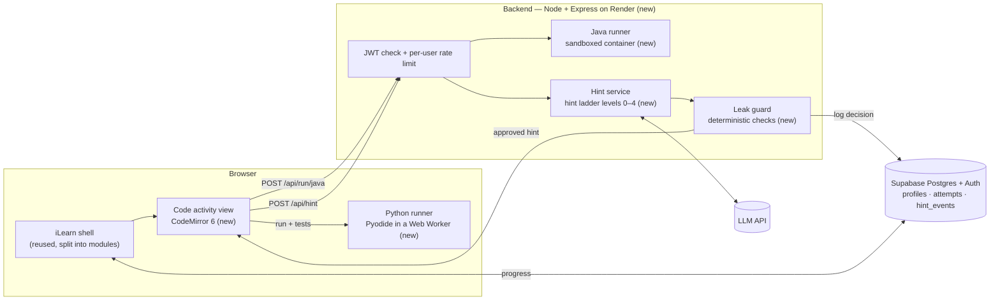

# Planned architecture

Draft for supervisor discussion. Tool choices still to be justified in the report (alternatives considered and rejected).

## Why a backend at all

iLearn is a static site. An LLM API key can't be shipped in a static page, for the same reason the
iLearn README already gives for the Supabase anon key: anything in the page is readable by every visitor.
A backend also allows real authentication and per-user rate limiting on paid LLM calls.

## Decisions to make and justify

| Decision | Options | Leaning | Decide by |
|---|---|---|---|
| Python execution | Pyodide in browser · server sandbox | Pyodide | Nov |
| Java execution | Judge0 CE (self-hosted) · Piston (Docker) · own Docker sandbox | Compare in Jan | 31 Jan |
| Editor | CodeMirror 6 · Monaco · textarea | CodeMirror 6 (lighter, accessible) | Dec |
| LLM | Compare 2–3 providers on cost, latency, hint quality | Decide from a small pilot | Dec |
| Leak guard | Deterministic rules · second-model validation (Phung et al. 2024) · both | Deterministic first, compare | Feb |
| Auth | Supabase Auth · own sessions | Supabase Auth | Dec |
